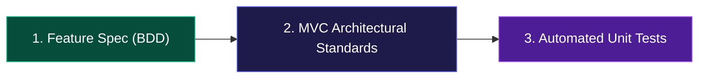

# Contributing to DistroTailor

Thank you for your interest in contributing to **DistroTailor**! Whether you are a human developer, an open-source contributor, or an AI coding agent, this guide outlines the mandatory workflow, architectural contracts, and quality standards for all code contributions.

---

## 🎯 The Three Mandatory Rules of Contribution

Every Pull Request, bug fix, or feature enhancement MUST adhere to these three core pillars:



### 1. Feature Specifications First (`specs/*.feature`)
- **Living Ground Truth:** All functional behaviors, decision logic, persona requirements, and UX states are defined as Gherkin `.feature` files in `specs/`.
- **Update or Add Scenarios Before Merging:** If your change modifies an existing behavior or introduces a new user capability, you **must** update the corresponding `.feature` file or add a new scenario (`Given / When / Then`).
- **Tech-Independent:** Keep `.feature` files focused on user goals, physical constraints, and verifiable outcomes rather than framework-specific implementation details.

### 2. Follow Client-Side MVC & Web Standards (Zero One-Off Hacks)
- **Zero Framework Bloat:** The web application is 100% vanilla Web Standards (W3C `EventTarget`, `CustomEvent`, History API, and standard DOM). Do not introduce Angular, React, Vue, or heavy state libraries.
- **Strict Architectural Contracts (`packages/web/src/types.ts`):**
  - **Model (`src/state/store.ts`):** Implements `IAppStore`. All state updates are unidirectional and dispatch via native `CustomEvent<'statechange'>`.
  - **Router (`src/state/router.ts`):** Implements `IAppRouter`. Manages bi-directional URL synchronization, browser history, schema migrations, and transition loop safeguards.
  - **View (`src/views/`, `src/components/`):** Pure, declarative rendering functions conforming to `ViewRenderer`. Views MUST be side-effect free and return HTML strings. Never attach DOM event listeners or perform mutations inside view templates.
  - **Controller (`src/handlers/events.ts`):** Implements `EventBinder`. Centralizes all DOM event listeners, input changes, and keyboard shortcuts, delegating updates to the store and router.
- **Zero Hardcoding in Views or Controllers:**
  - Catalogs, suggestion combos, and options belong in dedicated data modules:
    - [`packages/web/src/data/addon-combos.ts`](file:///Users/surenrao/Projects/distro-tailor/packages/web/src/data/addon-combos.ts) for distro addon combos.
    - [`packages/web/src/data/constraint-dictionary.ts`](file:///Users/surenrao/Projects/distro-tailor/packages/web/src/data/constraint-dictionary.ts) for constraint labels/emojis.
    - [`packages/web/src/data/expert-options.ts`](file:///Users/surenrao/Projects/distro-tailor/packages/web/src/data/expert-options.ts) for dropdown configurations.
  - Never inline static dictionaries or switch statements inside template renderers or event callbacks.

### 3. Mandatory Automated Unit Tests (`*.test.ts`)
- **Zero Regressions:** Every new feature, data catalog, utility, store action, or router migration MUST include automated tests.
- **Pure Node Test Execution:** All unit tests must execute natively using Node's test runner (`node --test`) or `tsx --test`. Tests must be lightweight, headless, and fast (sub-second execution).
- **Test Gate:** All tests across all workspaces must pass before code is committed:
  ```bash
  npm test
  ```

### 4. Scoring Regression Snapshot (Matcher & Affinity Changes)
`npm test` also runs `npm run scoring:check`, which evaluates the matcher over ~8,400 deterministic criteria combinations and compares a digest of the complete output with the ~100-byte `scripts/fixtures/scoring-fingerprint.json`. Any change to scores, reasons, or recipes fails the check, so algorithm changes are always deliberate and reviewable. On failure it automatically re-runs the matcher from the commit that last updated the fingerprint (straight from git, no stored snapshot) and prints what changed.

When you intend to change scoring (`engine/matcher.ts`, `taxonomy/affinities.ts`, `taxonomy/distros.ts`, or recipe selection):
1. Generate a review report against the last commit:
   ```bash
   npm run scoring:compare -- HEAD --report scoring-report.md
   ```
   The report lists how many top picks and recipes changed, and one representative case per top-pick transition with scores, profile facts, and match reasons before and after. It is sized for an AI assistant or reviewer to read in one pass.
2. Confirm hand-picked archetypes still pass: `npm run audit:matrix`.
3. Accept the new behaviour and commit the updated fingerprint alongside your change:
   ```bash
   npm run scoring:update
   ```

### 5. Pinned Recipe Downloads
Generated recipes verify every download against a SHA-256 pinned in `packages/core/src/generators/checksums.ts`, which is the single source for those versions, URLs, and hashes. A monthly GitHub Action (`.github/workflows/check-pins.yml`, also runnable by hand) runs `npm run check:pins` to re-verify each pin and to flag pinned Alpine or Buildroot releases that are near or past upstream end of support.

To bump a pinned release, change the version in `checksums.ts`, copy the new hash from the upstream checksum file noted beside it, then run:
```bash
npm run check:pins
npm test
```

---

## 🛠️ Development Workflow

### 1. Setup
```bash
git clone https://github.com/distro-tailor/distro-tailor.github.io.git
cd distro-tailor.github.io
npm install
npm run build
```

### 2. Running Verification Locally
Always verify the full pipeline before submitting:
```bash
# Run all unit tests across core and web
npm test

# Verify production compilation across core, cli, and web
npm run build

# Run local web dev server
npm run dev:web
```

---

## 🔒 Monorepo Package Responsibilities

| Package | Role & Invariants |
|---|---|
| **`@distro-tailor/core`** | **The Brain:** Pure TypeScript mathematical matching engine, distro taxonomies, recipe generators, and URL schema migrations. Zero DOM or browser dependencies. |
| **`@distro-tailor/web`** | **Visual Web App:** Client-side MVC application running in the browser. Zero server costs. Responsive, keyboard-accessible, and offline-ready. |
| **`@distro-tailor/cli`** | **Terminal Interface:** Fast interactive terminal wizard and non-interactive JSON API for scripts and terminal power users. |

---

## 📝 Commit Conventions

Use Conventional Commits for all local commits:
- `feat(scope):` New user-facing feature (e.g. `feat(web): add interactive view-all toggle for 31 contenders`)
- `fix(scope):` Bug fix (e.g. `fix(core): expose allMatches in RecommendationOutput`)
- `refactor(scope):` Architectural cleanups and extractions with no behavior change
- `test(scope):` Adding or updating automated tests
- `docs:` Documentation and specification updates

> [!IMPORTANT]
> **Git Invariant:** All changes must remain local and tested. Never execute `git push` unless explicitly approved or directed.
