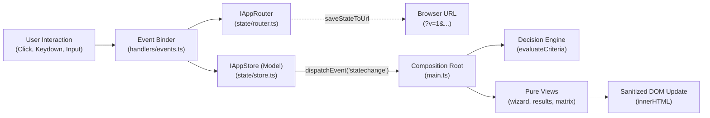

# 🏗️ DistroTailor: Architecture & System Design

This document details the software architecture, package hierarchy, decision engine algorithms, recipe generators, and bootloader topologies of DistroTailor.

---

## 📦 Monorepo Package Topology

DistroTailor is engineered as a clean, modular TypeScript monorepo with zero circular dependencies:

```
distro-tailor/
├── packages/
│   ├── core/                  # Pure TypeScript domain & engine (Node & Browser compatible)
│   │   ├── src/
│   │   │   ├── types.ts       # Domain taxonomy, criteria interfaces, profiles
│   │   │   ├── engine/
│   │   │   │   ├── matcher.ts         # Weighted constraint matching algorithm
│   │   │   │   ├── recipe-selection.ts # Ordered rules choosing the recipe generator
│   │   │   │   └── question-flow.ts   # Adaptive dynamic questionnaire director
│   │   │   ├── taxonomy/
│   │   │   │   ├── distros.ts         # Verified profile registry (31 distributions)
│   │   │   │   ├── affinities.ts      # Curated per-criterion distro affinity tables
│   │   │   │   ├── criteria-schema.ts # Criteria allowlists & sanitizer for untrusted input
│   │   │   │   └── questions.ts       # 20-Questions tree with contextual tips
│   │   │   └── generators/
│   │   │       ├── debootstrap.ts     # Debian minbase ISO generator
│   │   │       ├── kiosk.ts           # Alpine + Cage Wayland appliance builder
│   │   │       ├── buildroot.ts       # Embedded Buildroot defconfig generator
│   │   │       ├── alpine.ts          # Minimal apk chroot generator
│   │   │       ├── container.ts       # Multi-stage distroless container generator
│   │   │       ├── cloud-init.ts      # Cloud-init qcow2 VM image generator
│   │   │       ├── wsl.ts             # WSL2 rootfs tarball generator
│   │   │       ├── lxc.ts             # Proxmox LXC template generator
│   │   │       └── wasm.ts            # Browser WebVM (v86) assembler
│   │   └── src/**/*.test.ts   # Node.js native test runner suites
│   │
│   ├── web/                   # Client-side SPA (Vite + Tailwind CSS + Web Standards MVC)
│   │   ├── src/
│   │   │   ├── types.ts       # Web MVC contracts (IAppStore, IAppRouter, ViewRenderer, EventBinder)
│   │   │   ├── state/         # [MODEL] Reactive AppStore (EventTarget) & AppRouter
│   │   │   ├── utils/         # [HELPERS] DOM sanitizer (XSS protection) & formatters
│   │   │   ├── components/    # [VIEW PARTICLES] Reusable layout, chips, app suites, head-to-head
│   │   │   ├── views/         # [SCREENS] Pure HTML view renderers (wizard, results, expert matrix)
│   │   │   ├── handlers/      # [CONTROLLER] User actions & centralized event delegation
│   │   │   ├── main.ts        # Composition root & initial mount (~165 lines)
│   │   │   └── style.css      # Dark-mode styling and micro-interactions
│   │   └── vite.config.ts     # Aliased to core/src for instant HMR
│   │
│   └── cli/                   # Interactive terminal wizard & automation engine
│       └── src/
│           ├── index.ts       # CLI entrypoint & JSON API
│           └── wizard.ts      # Terminal interactive prompts
│
├── specs/                     # Gherkin behavior specifications (.feature files)
└── docs/                      # Architectural and product documentation
```

---

## 🧠 Decision Engine & Entropy Reduction (`matcher.ts`)

The core matching algorithm scores distributions against user criteria using a **normalized weighted constraint model**:

$$\text{Score} = \max\left(0, \min\left(100, \text{round}\left(\frac{\sum W_{\text{earned}}}{\sum W_{\text{max}}} \times 100\right)\right)\right)$$

### Constraint Weights Matrix:

| Criterion | Max Weight | Hard/Soft Gate | Evaluation Logic |
| :--- | :---: | :---: | :--- |
| **Primary Use Case** | **25 pts** (+2 flagship bonus) | Soft | Direct match against `distro.primaryUseCases`; bonus when it is the distro's first listed use case |
| **Platform Target** | **20 pts** | Soft (-10 penalty) | Direct match against `distro.platforms` |
| **CPU Architecture** | **20 pts** | **Hard Gate (score locked to 0%)** | Incompatible hardware disqualifies the distro outright (e.g. x86 binary on ARM) |
| **Storage & RAM Footprint** | **15 pts** (+2 exact tier bonus) each | Soft (-15 / -30 penalty) | Ordered hierarchy check (`micro` < `minimal` < `lean` < `standard` < `full`) |
| **Desktop Workflow Style** | **10 pts** | Soft | Evaluates Windows, macOS, Mobile/Touch, or Traditional ergonomics |
| **State Immutability** | **10 pts** | Soft | Compares `mutable`, `declarative`, `immutable-ostree`, `stateless-ram` |
| **C Library & Init** | **10 pts** | Soft (5 pts each) | `musl` vs. `glibc` and `systemd` vs. `busybox`/`openrc` |
| **Release Cadence & Drivers** | **10 pts each** | Soft | LTS vs Rolling, and Proprietary vs 100% Free Software |
| **Experience Level** | **5 pts** | Soft (-15 penalty) | Penalizes source-compilation systems (Buildroot) for beginners |

Alignment bonuses are included in $\sum W_{\text{max}}$, so only an exact alignment reaches 100% and near-misses no longer tie at the cap.

Criteria that depend on curated knowledge rather than profile attributes (form factor, workflow familiarity, driver philosophy, boot medium, pro audio, peripherals) are scored from ordered tier tables in `taxonomy/affinities.ts`. The first tier that applies to a distro wins, and a unit test verifies every referenced distro id exists in the registry. The recipe generator is then chosen by the ordered rules in `engine/recipe-selection.ts`.

---

## ⚙️ Turnkey Recipe Generators (`packages/core/src/generators/`)

When a user requires a bespoke operating system build rather than an off-the-shelf ISO, DistroTailor generates reproducible configuration and build scripts:

### 1. `debootstrap-debian` (Live Hybrid ISO)
- Bootstraps Debian `minbase` with `--no-install-recommends`.
- Generates a custom GRUB menu and builds a **hybrid BIOS/UEFI bootable ISO** via `grub-mkrescue`.
- Supports modular variables: `HARDWARE_TARGET`, `PRUNE_FIRMWARE=1`, `DESKTOP_ENV`, and `ENABLE_DISTROBOX=1`.

### 2. `kiosk-web` (Cage Wayland Single-App Appliance)
- Bootstraps an ultra-lightweight Alpine Linux rootfs (`musl libc`).
- Installs the **Cage** Wayland kiosk compositor.
- Injects an **auto-restart watchdog loop** that respawns the target binary (`APP_CMD`) if it exits or crashes.
- Employs OverlayFS for safe, uncorrupted power-cuts.

### 3. `buildroot-embedded` (Microcontroller / Embedded SBC)
- Cross-compiles Linux kernel, uClibc-ng or musl libc, and BusyBox userspace.
- Generates tiny root filesystems (< 8 MB) supporting NOMMU microcontrollers.
- Injects a tailored `distro.defconfig` with interactive `make menuconfig` support.

---

## 🥾 Bootloader Topology & Disk Structure

DistroTailor handles bootloader placement cleanly across different storage layouts:

```
┌────────────────────────────────────────────────────────────────────────┐
│                        PHYSICAL DISK (GPT)                             │
├──────────────────────────────┬─────────────────────────────────────────┤
│ Partition 1: ESP (FAT32)     │ Partition 2: Root Filesystem (ext4/etc) │
│ Mounted at: /boot/efi        │ Mounted at: /                           │
│                              │                                         │
│ ├── EFI/BOOT/BOOTX64.EFI     │ ├── /boot/vmlinuz (Kernel)              │
│ └── EFI/debian/grubx64.efi   │ ├── /boot/initrd.img (Drivers)          │
│                              │ └── /boot/grub/grub.cfg (Menu script)   │
└──────────────────────────────┴─────────────────────────────────────────┘
```

1. **UEFI Systems (Modern PCs/Macs):** The motherboard reads `BOOTX64.EFI` directly from the FAT32 EFI System Partition.
2. **Old Legacy BIOS Systems:** Sector 0 (MBR) jumps to GRUB Stage 2 in the unpartitioned post-MBR gap.
3. **Older MacBooks (2006–2008):** Hybrid GRUB bundles `grub-efi-ia32-bin` to bridge 64-bit kernels with 32-bit Apple EFI firmware.
4. **ARM / Raspberry Pi:** Bypasses GRUB entirely; GPU firmware (`start4.elf`) boots the kernel directly via device tree files.

---

## 🔗 URL State Persistence & Schema Versioning Invariant

DistroTailor persists all criteria, flow progress, and active views directly into the browser URL (`window.location.search` with hash fallback) to allow seamless sharing and bookmarking on static hosts like GitHub Pages.

### Strict Schema Version Invariant:
1. **Never Bump For Minor Releases:** Adding new distributions, expanding add-on recipes, adding helpful tips, or introducing optional non-breaking questions **MUST NOT** bump the schema version. The schema remains on `v=1`.
2. **Deploy-Gated Breaking Changes Only:** The schema version (`CURRENT_SCHEMA_VERSION`) is strictly updated **only upon official deployment** AND **only when a breaking change occurs** to parameter keys, removed taxonomy options, or incompatible criteria structures.
3. **Automated Migration Pipeline:** When a breaking change is deployed, a new migration step is registered in `SCHEMA_MIGRATIONS[oldVer]`. Old links arriving at the site are automatically upgraded, their address bar updated via `history.replaceState`, and the user's progress preserved.
4. **Graceful Fallback for Deprecated or Future Links:** If an incoming link uses an obsolete schema (`v < MINIMUM_SUPPORTED_SCHEMA_VERSION`) or a newer future schema (`v > CURRENT_SCHEMA_VERSION`), the application intercepts it before evaluation and renders a friendly Fallback Card with "Start Fresh" and "Browse All Distros" actions, guaranteeing zero white-screen crashes.

---

## 🏛️ Web Client Architecture & MVC Contracts (`packages/web`)

The single-page web client (`@distro-tailor/web`) implements a **zero-framework, client-side MVC architecture** built exclusively on standard W3C and ECMAScript specifications (`EventTarget`, `CustomEvent`, `URLSearchParams`, TypeScript generics).

### 1. Architectural Contracts (`packages/web/src/types.ts`)

To avoid "architectural drift" and maintain strict separation of concerns, the frontend explicitly defines and implements interfaces:

```typescript
// [MODEL CONTRACT]
export interface IAppStore {
  getState(): Readonly<AppState>;
  subscribe(listener: (state: Readonly<AppState>) => void): () => void;
  update(patch: Partial<AppState>): void;
  answerQuestion<K extends keyof UserCriteria>(questionId: string, answerKey: K, answerValue: UserCriteria[K]): void;
  removeChoice(criteriaKey: string): void;
  setFlowMode(mode: FlowMode): void;
  setTab(tab: AppTab): void;
  setActiveFileIndex(index: number): void;
  setShareModal(show: boolean): void;
  reset(cleanCriteria?: UserCriteria): void;
  pushHistory(): void;
  popHistory(): boolean;
}

// [ROUTER CONTRACT]
export interface IAppRouter {
  readonly inAppHistoryDepth: number;
  readonly isSyncing: boolean;
  checkLoopSafeguard(): boolean;
  resetLoopGuard(): void;
  saveStateToUrl(state: AppState, push?: boolean): void;
  stepBack(onFallbackStep: () => void): void;
}

// [VIEW CONTRACT]
export type ViewRenderer<TProps> = (props: TProps) => string;

// [CONTROLLER / EVENT BINDER CONTRACT]
export type EventBinder = (
  nextQuestion: Question | null | undefined,
  evaluation: RecommendationOutput,
  flow: QuestionFlow
) => void;
```

### 2. Unidirectional Reactive Data Flow



### 3. Layer Separation Guarantees
1. **Model (`state/store.ts`):** Single source of truth. Inherits `EventTarget`. Zero DOM references.
2. **Router (`state/router.ts`):** Isolates `window.history`, parameter parsing, and circuit-breaker loop safeguards.
3. **Views (`views/` & `components/`):** Pure HTML functions. Zero side-effects, zero event binding, 100% XSS-sanitized via `escapeHtml()`.
4. **Controller (`handlers/events.ts`):** Centralizes all UI interactions, hotkeys (numbers 1-9, Backspace, Escape), and dispatches typed actions to Store and Router.
5. **Entrypoint (`main.ts`):** Lightweight orchestrator (~165 lines) that connects Store events to top-level view rendering.
