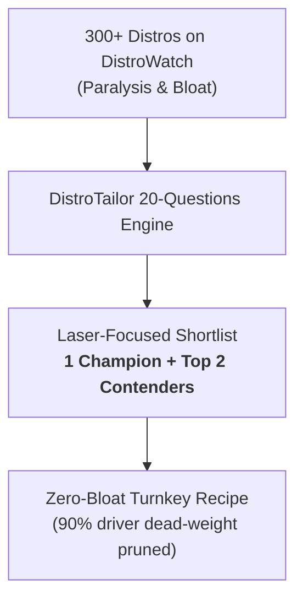
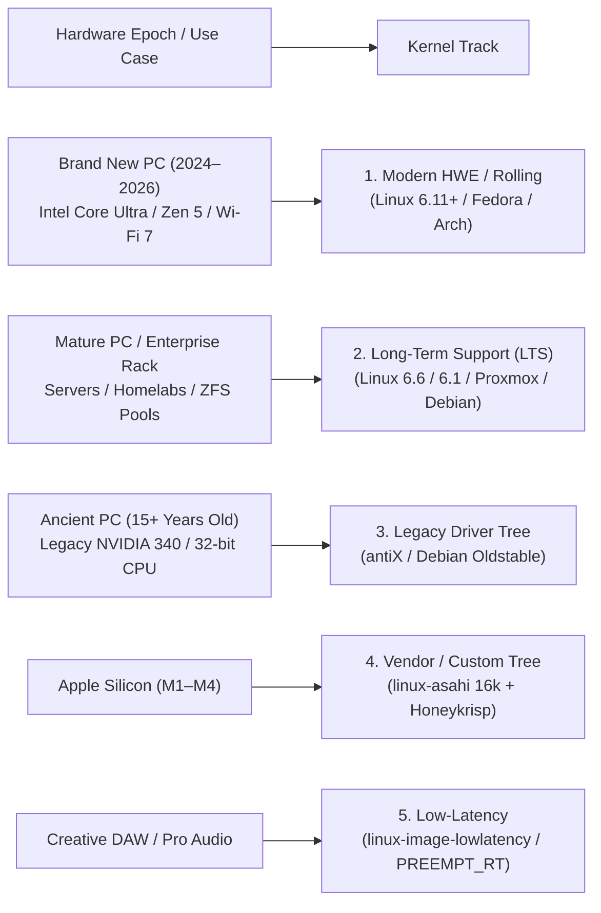

# 💡 Design Rationale, Q&A & Architectural Decisions

This document captures the core questions, design rationales, and architectural decisions thought through while architecting and implementing **DistroTailor**. It serves as an institutional knowledge repository and living decision log for contributors, maintainers, and autonomous agents.

---

## 🧭 1. Philosophy & Problem Space

### Q1.1: Why go from a matrix of thousands of Linux distros to a goal/hardware-specific narrow list?
* **Context:** DistroWatch tracks over 300 active Linux distributions, with thousands of historical derivatives. Traditional advice invites "distro-hopping" and endless forum debates where advocates recommend distributions based on personal ideology rather than user requirements.
* **Decision:** DistroTailor operates as an **inverted funnel**. In 30 to 60 seconds (3 to 4 plain-English questions), the user defines their **User Goal** (e.g., Home Office, Proxmox Hypervisor, Blender Studio) and **Silicon Archetype** (e.g., PCPartPicker Custom Rig, Apple Silicon Mac, Used Server Rack).
* **Rationale:**
  1. **Destroys Option Paralysis:** Eliminates the need to understand package managers, systemd vs OpenRC, or release cadences before having a working computer.
  2. **Yields 1 Champion + 2 Contenders:** The user receives a high-confidence primary match along with transparent trade-offs and top alternatives.
  3. **Turnkey Actionability:** Pairs every recommendation with modular add-on combos and an automated build recipe that prunes dead weight.



---

## 🧩 2. Flavors, Desktops & Application Ecosystem

### Q2.1: Do we have to maintain a master list of all distros, desktop flavors (GNOME, KDE, XFCE), and apps?
* **Decision:** **No.** Maintaining a manual encyclopedia of hundreds of distros, every desktop spin (Kubuntu, Xubuntu, Lubuntu, Fedora KDE Spin, Fedora Silverblue), and thousands of desktop apps would create an unmaintainable maintenance trap.
* **Architecture:** DistroTailor implements a **3-Layer Composable Architecture**:
  1. **Layer 1: Anchor Base OS (~25–30 Curated Archetypes):** Foundational distributions that represent distinct system architectures, state models, and libc ecosystems (e.g., Debian, Fedora, Arch, Alpine, Proxmox VE, TrueNAS SCALE, LibreELEC, Batocera, Asahi Linux).
  2. **Layer 2: Desktop Flavors as Composable Modifiers:** In Linux, a desktop environment is merely a package layer, not a separate OS. Kubuntu is Ubuntu + `kubuntu-desktop`. Fedora KDE is Fedora + `@kde-desktop`. DistroTailor exposes `DESKTOP_ENV ?= gnome | kde | xfce | sway` as a composable parameter in recipes.
  3. **Layer 3: Application Ecosystem via Flathub & AppStream:** Rather than hosting a custom app catalog, DistroTailor delegates application delivery to standard Flathub IDs (`org.kde.krita`, `org.blender.Blender`, `org.onlyoffice.desktopeditors`) and native distro package managers (`apt`, `dnf`, `pacman`).

| Layer | Maintained by DistroTailor? | How It Works |
| :--- | :--- | :--- |
| **Anchor Distros & Archetypes** | **Yes (~25–30 Profiles)** | Curated profiles in `packages/core/src/taxonomy/distros.ts` capturing real architectural differences (init, libc, immutability, hardware). |
| **Desktop Flavors (GNOME / KDE / XFCE)** | **No (Composable Parameter)** | `DESKTOP_ENV` variable in Makefiles mapping to distro meta-packages. |
| **Applications (Office, 3D, Audio)** | **No (Delegated to Ecosystem)** | Standard Flathub IDs and native package repositories. |
| **Hardware Driver Matrix** | **No (Kernel Discovery)** | Standard Linux kernel discovery tools (`lspci`, `usb.ids`, `localmodconfig`). |

---

## ⚡ 3. Kernel Lifecycles & Hardware Epochs

### Q3.1: How do we handle Linux kernel versions (old vs new, LTS vs rolling)?
* **Context:** Chasing kernel point releases (e.g. 6.11.2 vs 6.11.3) creates rapid obsolescence. Furthermore, users often do not know which kernel version they need.
* **Decision:** DistroTailor maps user hardware to **Hardware Epochs** and **4 Kernel Tracks**:



* **In Recipe Generation:** Debootstrap and Makefiles parameterize kernel installation via `KERNEL_TRACK ?= hwe | lts | lowlatency | backports`. For example, Ubuntu recipes install `linux-image-generic-hwe-24.04`, which automatically rolls forward to the latest hardware enablement point release every 6 months.

---

## 🖥️ 4. Silicon Archetypes: PCPartPicker vs. Closed Hardware

### Q4.1: Why distinguish custom PCPartPicker rigs from fixed hardware like MacBook or Mac Studio?
* **Fixed Closed Silicon (MacBook, Mac Studio, Raspberry Pi):**
  - The bill of materials (SoC, GPU cores, Wi-Fi chip, display controller, audio DAC) is **100% deterministic**.
  - Packaging 30,000 generic drivers from a standard 4GB ISO is 99% dead weight.
  - DistroTailor routes these to dedicated upstream distributions (Asahi Linux, Raspberry Pi OS) that package the exact required device tree and firmware.
* **Modular Custom Silicon (PCPartPicker builds):**
  - Custom rigs use modular commodity parts: one specific Ethernet NIC, one Wi-Fi chip, one audio controller, and one GPU (NVIDIA, AMD, or Intel).
  - DistroTailor recommends the ideal desktop base and provides a `detect-hardware` target in the build recipe:
    ```bash
    make detect-hardware
    ```
    This runs `lspci -nnk`, cross-references active device IDs against `modules.alias`, and generates a streamlined kernel configuration via `make localmodconfig`, shedding gigabytes of unnecessary drivers.

---

## 🖧 5. Enterprise Server Racks & Homelab Virtualization

### Q5.1: How do we support used 1U/2U/4U enterprise server racks acquired from Craigslist or eBay?
* **Context:** Enthusiasts frequently purchase decommissioned enterprise servers (Dell PowerEdge R720/R730, HP ProLiant DL380, Supermicro) for home virtualization, storage, and networking. These machines feature dual Xeon/EPYC CPUs, hundreds of gigabytes of ECC RAM, multi-gigabit NICs, and multi-bay SAS/SATA backplanes.
* **Decision:** DistroTailor added dedicated profiles for **`proxmox-ve`** and **`truenas-scale`**:
  - **Proxmox VE (🖧):** Recommended for virtualization and container density (`hypervisor-vms`). Highlights web GUI cluster management, LXC containers, KVM virtualization, and ZFS out of the box.
  - **TrueNAS SCALE (🦈):** Recommended for multi-bay storage arrays (`nas-storage` with appliance model). Highlights enterprise OpenZFS, Docker app ecosystem, and read-only immutable system root.
* **Tiebreaker Rationale:** While OpenMediaVault excels at turning an old desktop or Raspberry Pi into a lightweight family NAS, TrueNAS SCALE is prioritized for enterprise multi-bay server racks requiring 8GB+ ECC RAM and ZFS scrubbing.

---

## 💼 6. Freelancers, Home Office & Creative Workstations

### Q6.1: How does DistroTailor cater to remote knowledge workers and digital creatives?
* **Freelance Home Office (`home-office`):**
  - **Distro Champion:** **Linux Mint** (Beginner) and **Fedora Workstation** (Intermediate).
  - **Key Capabilities:**
    - 100% Microsoft Office document fidelity via OnlyOffice Desktop Editors and LibreOffice.
    - Timeshift 1-click snapshot restore: protects client deliverables from accidental system breakages.
    - Standalone Web App wrappers for Microsoft 365, Google Workspace, Zoom, and Slack.
* **Creative Multimedia Studio (`creative-studio`):**
  - **Distro Champion:** **Ubuntu Studio** (🎨).
  - **Key Capabilities:**
    - Low-latency Linux kernel tuned for real-time DAW audio recording and video rendering preview.
    - Pre-calibrated drawing tablet support (Wacom, Huion, XP-Pen).
    - Complete open-source creative suite pre-installed: Blender (3D), Krita (digital painting), Inkscape (vector design), Darktable (RAW photo), GIMP, and Kdenlive.
    - Curated add-on guides for DaVinci Resolve and PipeWire pro-audio routing.

---

## 🔗 7. URL Sharing, State Persistence & Schema Invariants

### Q7.1: How does URL sharing work, and how do we prevent breaking existing links across deployments?
* **Context:** Users must be able to bookmark, share via Discord/Reddit, or link their exact 20-Questions criteria and recommendations without state loss.
* **Design:** State is serialized into `window.location.search` (with `#` hash fallback for static CDNs):
  ```
  https://distrotailor.dev/?v=1&useCase=home-office&platform=bare-metal&architecture=x86_64
  ```
* **The Schema Version Invariant:**
  - `CURRENT_SCHEMA_VERSION = 1`
  - **Invariant:** The schema version is **ONLY** bumped upon actual production deployment **AND** only when there are breaking changes to parameter names or serialization semantics.
  - Non-breaking changes (adding new distros, new questions, or updated add-on combos) **NEVER** bump the schema version.
* **Universal Interface Parity:** URL ingestion and schema migration run identically across all interfaces:
  - **Web UI:** Loads via `loadStateFromUrl()`, renders "Viewing Shared Build" banner, and provides an interactive Share Modal.
  - **CLI:** `distro-tailor recommend --url "<url>"` and `distro-tailor export --url "<url>"`.
  - **API:** Node.js library method `migrateUrlParameters(params)`.
* **Graceful Deprecation Fallback:** If a URL carries an unsupported schema version (`v=0` or `v=99`), DistroTailor displays a friendly fallback card with options to *"Start Fresh"* or *"Browse Contenders"*, preventing unhandled runtime exceptions.

---

## 🧪 8. The 3-Tier Verification & Testing Ladder

### Q8.1: In order to test the final output, what instructions do we provide to users?
* **Problem:** Telling a user *"here is an ISO or Makefile"* without a progressive testing path leads to fear of wiping their main operating system or abandoning the build.
* **Architecture:** DistroTailor implements a **3-Tier Testing & Verification Ladder** in both the Web UI and recipe README:
  1. **Tier 1: In-Browser Instant Sandbox (Zero Risk):**
     - Emulates an x86 PC client-side inside the browser tab via WebAssembly (`v86` PC emulator).
     - Allows users to test-drive shell commands and boot scripts with 0% risk to their hard drive.
  2. **Tier 2: Safe VM Sandbox (Local Hypervisor):**
     - Tests the generated `.iso` inside **QEMU**, **VirtualBox**, or **UTM** (macOS).
     - Provides one-liner commands:
       ```bash
       # Linux (KVM hardware acceleration):
       qemu-system-x86_64 -cdrom output/*.iso -m 2048 -enable-kvm

       # macOS (Apple Hypervisor acceleration):
       qemu-system-x86_64 -cdrom output/*.iso -m 2048 -accel hvf
       ```
  3. **Tier 3: Direct Bare-Metal Hardware (Live USB / Machine Boot):**
     - Flash instructions using cross-platform GUI tools (**BalenaEtcher**, **Raspberry Pi Imager**, **Rufus**) or terminal `dd`.
     - Hardware boot key cheatsheet: **F12** (Dell, Lenovo), **F11/F12** (HP, MSI), **Del/F8** (ASUS), **Option ⌥** (Mac).
     - Tests hardware Wi-Fi, audio codecs, and GPU acceleration live in RAM without modifying internal storage.

---

## 📦 9. Expanded Output Types & Delivery Paradigms

### Q9.1: What are all the output types DistroTailor generates across computing form factors?
* **Problem:** Limiting output to ISOs ignores developers on Windows, homelab operators running Proxmox clusters, and embedded engineers.
* **Architecture:** DistroTailor supports **9 distinct output formats** spanning physical, cloud, and containerized platforms:

| Output Format | Target Platform | Generated Artifacts & Capabilities |
| :--- | :--- | :--- |
| **`iso`** | Physical PCs, Laptops, Macs | Hybrid BIOS/UEFI Live ISO with tailored kernel and pruned firmware. |
| **`disk-image`** | Raspberry Pi / SD Cards | Raw `.img` partition layout ready for direct flashing. |
| **`qcow2`** | Proxmox VE, KVM, OpenStack | Sparse virtual disk image with `cloud-init` and QEMU guest agent. |
| **`wsl2`** | Windows 10/11 Subsystem for Linux | Zero-kernel rootfs tarball (`rootfs.tar.gz`) + `wsl.conf` + PowerShell installer. |
| **`lxc-template`** | Proxmox VE, Incus, LXD | High-density `.tar.xz` container template (<25MB RAM on boot). |
| **`dockerfile`** | Docker, Podman, Kubernetes | Multi-stage minimal container image based on Alpine or Distroless. |
| **`buildroot`** | Microcontrollers & SBCs | Cross-compiled kernel and BusyBox `distro.defconfig`. |
| **`tarball`** | Custom RootFS / Chroot | Minimal root directory archive for bootstrapping and provisioning. |
| **`wasm-browser`** | Web Browsers | Standalone HTML with `v86` WebAssembly 32-bit x86 emulator. |

---

## 📋 Summary Table of Archetypes & Flagships

| User Goal / Hardware Archetype | Flagship Recommendation | Key Architectural Trait |
| :--- | :--- | :--- |
| **Living Room TV / Media Player** | **LibreELEC** | Read-only RootFS, 3-second boot, HDMI-CEC Kodi |
| **Family NAS & Photo Cloud** | **OpenMediaVault** | Lightweight Debian base, Immich, SMB/NFS |
| **Enterprise Server Rack (Craigslist)** | **Proxmox VE / TrueNAS SCALE** | KVM hypervisor, LXC clustering, Enterprise OpenZFS |
| **Smart Home Automation Hub** | **Home Assistant OS** | Immutable A/B rootfs, Zigbee/Matter local privacy |
| **Dedicated Appliance / Retail Kiosk** | **Cage Wayland Appliance** | Micro debootstrap, kiosk lockdown, systemd watchdog |
| **Retro Gaming Console** | **Batocera.linux** | Dedicated EmulationStation rootfs, gamepad-driven |
| **Modern AI & GPU Compute** | **Pop!_OS** | Pre-compiled NVIDIA drivers, CUDA 12, PyTorch ready |
| **Apple Silicon (M1–M4)** | **Fedora Asahi Remix** | 16k page-size kernel, conformant Rust Vulkan driver |
| **Freelance Home Office** | **Linux Mint / Fedora** | OnlyOffice MS fidelity, Timeshift 1-click restore |
| **Creative Multimedia Studio** | **Ubuntu Studio** | Low-latency kernel, Wacom calibration, creative suite |
| **Microcontroller / NOMMU** | **Buildroot Embedded** | Under 16MB footprint, custom BusyBox C library |
